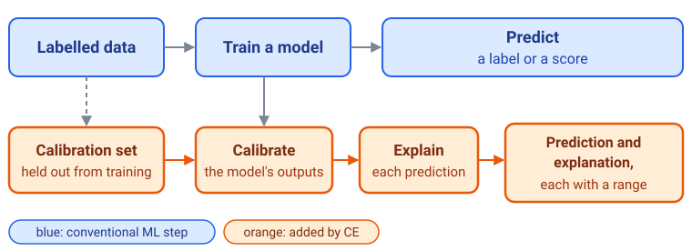

# Quick Start — Understand, Explore and Apply CE

**Calibrated Explanations (CE)** is a Python library that works with your
classification or regression model. It calibrates the model's predictions on
data the model has not seen, gives each prediction a range (a lower and an
upper value), and explains each prediction with a range for every feature's
contribution.

**What CE gives you**

- **Calibrated predictions with ranges.** For classification, a calibrated
  probability with a lower and an upper value. For regression, a prediction
  with an interval, or the probability that the outcome is at or below a
  threshold you choose.
- **Factual explanations.** The feature conditions behind one prediction,
  each with a weight and a range for that weight.
- **Alternative explanations.** What the calibrated prediction would be if
  one feature had a different value.
- **Your own model.** CE wraps scikit-learn-style classifiers and regressors,
  trained or not, and leaves the model itself unchanged.

What the ranges mean differs by task, and CE's guarantees assume that the
calibration data and new cases come from the same stable process.

This Quick Start gives you the big picture without code. It links to the
Python tutorials when you want to run CE, and to the theory when you want the
mathematics.

## Where CE fits

```{raw} html
<figure class="ce-figure">
  <a href="why-ce.html" title="Why CE: the full workflow, explained">
    <picture>
      <source media="(max-width: 600px)" srcset="../_static/figures/ce-at-a-glance-narrow.svg">
      
    </picture>
  </a>
  <figcaption>Blue: a conventional ML workflow. Orange: what CE adds. Schematic; the full workflow is explained in <a href="why-ce.html">Why CE</a>.</figcaption>
</figure>
```

You keep your model and your training. CE adds a **calibration set** held out
from training, a **Calibrate** step and an **Explain** step. In return, every
prediction and every explanation comes with a range.

## Choose your path

::::{grid} 1 1 3 3
:gutter: 3

:::{grid-item-card} A · Understand CE
:link: why-ce
:link-type: doc

**Why is CE needed, and what changes in the workflow?** For newcomers,
students and decision-makers.
:::

:::{grid-item-card} B · Learn CE by example
:link: ce-by-example
:link-type: doc

**What does CE produce for one real prediction, and how do you read it?**
Real CE output, explained step by step.
:::

:::{grid-item-card} C · Apply CE to your data
:link: ce-tasks-and-modes
:link-type: doc

**Does CE fit my problem, and what does applying it involve?** Tasks, modes
and the practical workflow, with links to the Python tutorials.
:::
::::

**Recommended order:** A → B → C. Each path also stands on its own: if you
already know machine learning and CE's ideas, go straight to B; if you only
need to know whether CE fits your problem, start with C.

## Before you start

- **Install:** see {doc}`installation` (Python 3.10 or later).
- **Run CE:** the {doc}`Python tutorials <../tutorials/index>` have executable
  examples with real output; the {doc}`Quick API <quick_api>` lists the main
  calls.
- **Look things up:** the {doc}`Glossary <../glossary/index>` defines the terms,
  and the {doc}`API reference <../api/index>` gives full signatures.
- **Go deeper:** {doc}`../foundations/concepts/ce_workflow` gives a learning
  path from intuition to the mathematics. Guarantees are mode-specific; the
  canonical statement is {doc}`../foundations/concepts/calibrated_interval_semantics`.
- **Try it in the browser:** the
  [interactive web demo](https://calibrated-explanations-demo.ju.se/) shows CE
  without installing anything.

(quick-start-next)=

## Where should I go next?

| Section | Go there to |
|---|---|
| {doc}`CE: What & Why <../sections/what-and-why>` | Understand why trusting AI outputs is hard, what CE adds and how it compares with other methods |
| {doc}`How CE Works <../sections/how-ce-works>` | Study the theory: calibration methods, guarantees by mode and how explanations are built |
| {doc}`CE in Practice <../sections/in-practice>` | Run the Python tutorials, try the demos, follow task guides and evaluate CE on your data |
| {doc}`CE Software & Integration <../sections/software-integration>` | Install, look up the API, integrate CE into pipelines and fix problems |
| {doc}`Project & Resources <../sections/project-evolution>` | Find the research and publications, how to cite CE, the roadmap and how to contribute |
| [Commercial Services](https://grejna.ai/#kontakt) | Contact Grejna AB for customized CE solutions and commercial support, separate from the open-source library and its license |

```{toctree}
:hidden:
:maxdepth: 1

A1 · Machine learning essentials <ml-foundations>
A2 · Why CE: from a conventional to a CE workflow <why-ce>
B · CE by example <ce-by-example>
C1 · Tasks, modes and capabilities <ce-tasks-and-modes>
C2 · Apply CE: the practical workflow <apply-overview>
```

Entry-point tier: Tier 1.
