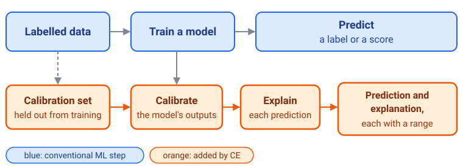

# Get started

<span id="quick-start-understand-explore-and-apply-ce"></span>

**Calibrated Explanations (CE)** wraps a classification or regression model
you already have. It calibrates the model's outputs on labelled data the model
has not seen, then explains each calibrated prediction, with a range for the
prediction and for every feature's weight.

**You need:**

| You need | Details |
|---|---|
| Python 3.10 or later | Tested on Python 3.10 to 3.13 |
| A scikit-learn-style model | `fit` and `predict`; a classifier also needs `predict_proba` |
| Labelled data you can split three ways | Training, **calibration** (never shown to the model) and test |

## Where CE fits

```{raw} html
<figure class="ce-figure">
  <a href="why-ce.html" title="Why CE: the full workflow, explained">
    <picture>
      <source media="(max-width: 600px)" srcset="../_static/figures/ce-at-a-glance-narrow.svg">
      
    </picture>
  </a>
  <figcaption>Blue: a conventional ML workflow. Orange: what CE adds. Schematic; the full workflow is explained in <a href="why-ce.html">Why CE</a>.</figcaption>
</figure>
```

Follow the arrows from labelled data through training to prediction: these
are the conventional steps. The branch labelled **Calibration set** supplies
held-out examples to **Calibrate**, and **Explain** uses the calibrated
outputs to construct explanations. The final box groups the prediction and
explanation, each with a reported range. These ranges describe different
quantities; their meaning depends on the task and output, as the paths below
explain. CE adds these steps without retraining your model.

(choose-your-path)=

## Your learning journey

Five steps, each about 2 to 30 minutes. Every page ends with a link to the next.

1. **{doc}`Install <installation>` (2 minutes).**
   `pip install "calibrated-explanations[viz]"`; the `viz` extra adds plots.
2. **{doc}`Quickstart: your first explanation <quickstart>` (10 minutes): start here.**
   Train a model, calibrate it, and explain one prediction, with every output
   shown.
3. **{doc}`Read your first explanation <../foundations/how-to/interpret_explanations>` (15 minutes).**
   Which number is the prediction, which is a weight, and what each range is.
4. **{doc}`Apply CE to your own data <apply-to-your-data>` (30 minutes).**
   Split, wrap, calibrate, explain, check and save.
5. **{doc}`Evaluate CE on your own data <../practitioner/evaluate_ce>` (30 minutes).**
   Are the probabilities calibrated and the intervals wide enough on *your*
   held-out data?

**Prefer to see the result before writing code?** {doc}`CE by example <ce-by-example>`
shows the Quickstart's prediction without code (15 minutes). The
{doc}`Python walkthrough <quickstart_walkthrough>` is the in-depth version of
step 2, and the {doc}`Quick API <quick_api>` page is a compact reference of
the calls.

**Coming from SHAP or LIME?** {doc}`Map your workflow to CE <coming-from-shap-lime>`.

**Want the reasons first?** {doc}`Why CE <why-ce>` explains what changes in a
machine-learning workflow when CE is added.

## Which CE task am I doing?

| Your target | CE mode | Prediction call |
|---|---|---|
| A class | Classification | `predict_proba(X, uq_interval=True)` |
| A number, with an interval | Interval regression | `predict(X, uq_interval=True)` |
| The probability that a number is at most *t* | Probabilistic regression | `predict_proba(X, uq_interval=True, threshold=t)` |

Every mode explains with `explain_factual(X)` and `explore_alternatives(X)`.
More detail: {doc}`Tasks, modes and capabilities <ce-tasks-and-modes>`.
What each range guarantees differs by mode: see
{doc}`../foundations/concepts/calibrated_interval_semantics`.

(before-you-start)=

## Reference and further reading

- **Look things up:** the {doc}`Glossary <../glossary/index>` defines the terms,
  and the {doc}`API reference <../api/index>` gives full signatures.
- **Go deeper:** {doc}`../foundations/concepts/ce_workflow` gives a learning
  path from intuition to the mathematics.
- **Try it in the browser:** the
  [interactive web demo](https://calibrated-explanations-demo.ju.se/) shows CE
  without installing anything.

(quick-start-next)=

## Where should I go next?

| Section | Go there to |
|---|---|
| {doc}`CE: What & Why <../sections/what-and-why>` | Understand why trusting AI outputs is hard, what CE adds and how it compares with other methods |
| {doc}`How CE Works <../sections/how-ce-works>` | Study the theory: calibration methods, guarantees by mode and how explanations are built |
| {doc}`CE in Practice <../sections/in-practice>` | Run the Python tutorials, try the demos, follow task guides and evaluate CE on your data |
| {doc}`CE Software & Integration <../sections/software-integration>` | Install, look up the API, integrate CE into pipelines and fix problems |
| {doc}`Project & Resources <../sections/project-evolution>` | Find the research and publications, how to cite CE, the roadmap and how to contribute |
| [Commercial Services](https://grejna.ai/#kontakt) | Contact Grejna AB for customized CE solutions and commercial support, separate from the open-source library and its license |

```{toctree}
:hidden:
:maxdepth: 1

Installation <installation>
Quickstart <quickstart>
Read Your First Explanation <../foundations/how-to/interpret_explanations>
Apply CE to Your Own Data <apply-to-your-data>
Evaluate CE <../practitioner/evaluate_ce>
CE by Example (No Code) <ce-by-example>
Coming from SHAP or LIME <coming-from-shap-lime>
```
